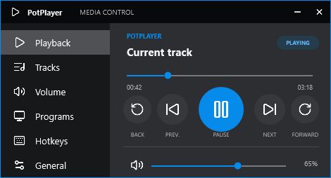
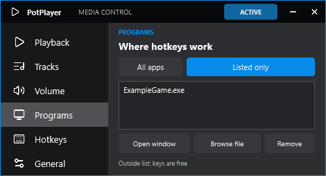
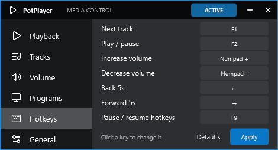
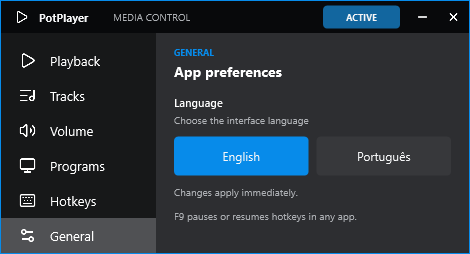
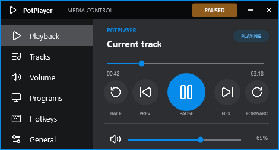

# MediaControl

MediaControl is a compact Windows controller for [PotPlayer](https://potplayer.daum.net/). It lets you skip tracks, pause, seek, and change PotPlayer's volume while another app or game is in the foreground. It is based on the `MusicControl.ahk` workflow, with configurable hotkeys, a program allowlist, and a system tray icon.

The interface supports **English (default)** and **Português**. Change it anytime in **General**.

## Screenshots

| Playback | Allowed programs |
| --- | --- |
|  |  |

| Hotkeys | Language |
| --- | --- |
|  |  |

[Open window picker](docs/screenshots/window-picker-en.png) · [Interface em português](docs/screenshots/general-pt-BR.png)



## Download and use

1. Download `MediaControl-Setup-...-win-x64.exe` from the [latest release](https://github.com/xsolbe/MediaControl/releases/latest) and run the installer. It adds MediaControl to the Start menu, offers an optional desktop shortcut, and can be removed through Windows **Installed apps**.
2. Start PotPlayer, then open MediaControl from the Start menu. The app requests administrator permission so its hotkeys also work while an elevated game is active.
3. In **Programs**, add a running window or choose an executable. Adding a program switches to **Listed only** automatically. MediaControl then responds to hotkeys only while a listed program is in the foreground. Outside the list, those keys remain available to the active app.
4. Use **Hotkeys** to change a binding, then click **Apply**. Use **General** to change the interface language.

Press **F9** to pause or resume MediaControl's hotkeys from any app, including a listed game. While paused, F1, F2, and the other media keys are released to the game. F9 stays active, even when MediaControl is in the system tray. The pause state is saved across restarts. You can also click the **ACTIVE / PAUSED** badge or use the tray menu. Mouse controls in the app remain available.

The **−** button sends MediaControl to the system tray. Click the tray icon to reopen it, or right-click for **Open MediaControl** and **Exit**. The **×** button exits. Settings are saved in `%AppData%\MediaControl\settings.json`.

If you previously used the portable app, exit it from its tray menu before opening the installed copy. The installer uses the same settings file, so your hotkeys, language, and program list carry over. Uninstalling leaves that settings file in place.

### Default hotkeys

| Key | PotPlayer action |
| --- | --- |
| F1 | Next track |
| F2 | Play / pause |
| Numpad + | Increase volume |
| Numpad − | Decrease volume |
| ← | Seek backward |
| → | Seek forward |
| F9 | Pause / resume MediaControl hotkeys (always available) |

The playback panel also has a previous-track button, a timeline, and volume and mute controls. The default commands use the same PotPlayer messages as the original AHK script. The icons are from [Lucide](https://lucide.dev/); its license is included in [`Assets/Lucide/LUCIDE-LICENSE.txt`](Assets/Lucide/LUCIDE-LICENSE.txt).

## Português

O MediaControl controla músicas no PotPlayer enquanto você usa outro programa ou joga. F1 passa para a próxima faixa, F2 pausa ou continua, as teclas do teclado numérico ajustam o volume e as setas avançam ou voltam na música. Os atalhos podem ser alterados na aba **Atalhos**.

Baixe o `MediaControl-Setup-...-win-x64.exe` na [página de releases](https://github.com/xsolbe/MediaControl/releases/latest) e execute o instalador. Ele cria um atalho no menu Iniciar, pode criar outro na área de trabalho e aparece em **Aplicativos instalados** para desinstalação. Se você já usa a versão portátil, feche-a pelo menu da bandeja antes de abrir a instalada; seus atalhos, idioma e lista de programas continuam salvos.

Em **Programas**, adicione um jogo pela janela aberta ou pelo arquivo executável. Isso ativa **Somente lista**: os atalhos controlam o PotPlayer apenas quando um programa cadastrado está em primeiro plano. Fora da lista, as teclas continuam disponíveis para o programa ativo. Na aba **Geral**, selecione **Português**. O botão **−** envia o app para a bandeja; **×** fecha o app.

Pressione **F9** para pausar ou reativar os atalhos de qualquer programa. Durante a pausa, F1, F2 e as demais teclas ficam livres para o jogo; F9 continua ativo. O estado de pausa é salvo ao fechar o app. O indicador **ATIVO / PAUSADO** e o menu da bandeja também permitem alternar.

## Build

Requires the .NET 10 SDK and [Inno Setup 6](https://jrsoftware.org/isdl.php) on Windows. Build the installer with:

```powershell
.\tools\build-installer.ps1
```

The self-contained installer and its SHA-256 file are written to `artifacts\installer`. The build script reads the app version from `MediaControl.csproj`.
